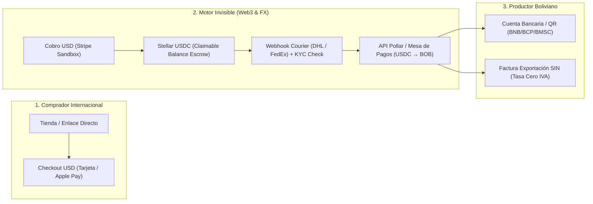

# NODO | Pasarela de Pagos & E-commerce Transfronterizo
### Conectando Productores Bolivianos con Compradores Internacionales

> Prototipo interactivo, simulador end-to-end y arquitectura de referencia para una pasarela de pagos fintech transfronteriza inspirada en el modelo de **Mesa de Pagos** ([mesadepagos.com](https://mesadepagos.com/es/about)).

---

## 1. Concepto Central y Regla de Oro de UX

* **Propuesta de valor:** El comprador internacional en Estados Unidos o Europa paga en dólares americanos (**USD**) mediante tarjeta de crédito/débito o Apple Pay habitual. El productor boliviano recibe sus ganancias líquidas directamente en bolivianos (**BOB**) en su cuenta bancaria nacional (BNB, BMSC, BCP, Bisa, Unión) o QR interoperable, a un **tipo de cambio de mercado altamente competitivo** (ej. ~10.50 BOB/USD vs. 6.96 oficial bancario).
* **Tecnología invisible:** Ni el comprador ni el productor ven jerga cripto, wallets ni interactúan con blockchains. Toda la infraestructura opera de forma oculta en segundo plano y solo se visualiza bajo demanda en el **"Modo Evaluador / Ver Motor Invisible"**.
* **Estado global sincronizado en tiempo real:** Si se realiza una compra en la *Vista Comprador*, la orden aparece inmediatamente en el *Panel del Productor*; al ingresar y validar la guía de courier allí, se actualiza el tracking del comprador; y al confirmar la entrega (webhook simulado), se dispara la liberación del Escrow y el abono bancario en Bolivia.

---

## 2. Arquitectura del Sistema



---

## 3. Módulos y Funcionalidades

### A. Vista Comprador Internacional (USD)
1. **Catálogo de Exportación de Alto Valor:** Café de especialidad de los Yungas (Caranavi), chalina de Baby Alpaca hecha a mano (La Paz), Singani de Altura Gran Reserva D.O. (Tarija), bolso de cuero curtido vegetal (Tupiza).
2. **Enlace de Pago Directo:** Botón *"Copiar enlace de pago"* en cada producto para compras directas tipo WhatsApp/Instagram.
3. **Checkout Transparente:**
   - Desglose exacto: Producto USD + Envío Internacional Express (DHL) + Garantía Escrow de Compra Protegida ($0.00).
   - Formulario de tarjeta con botones de prueba rápida: *"Simular Pago Exitoso"* y *"Simular Tarjeta Rechazada"*.
4. **Tracking Post-Compra & Disputas:**
   - Barra de 4 etapas: *Pago confirmado → En garantía (Escrow) → Despachado con tracking → Entregado*.
   - Comprobante digital de compra imprimible.
   - Botón *"Reportar Problema / Abrir Disputa"* para congelar fondos y solicitar arbitraje.

### B. Vista Productor Boliviano (BOB)
1. **Verificación de Identidad (KYC / AML):**
   - Validación de Razón Social, Cédula de Identidad con extensión (LP, SC, CB, etc.), NIT y Régimen Tributario.
   - Vinculación de Cuenta Bancaria o QR interoperable (ASOBAN).
   - **Regla estricta:** Bloquea la liquidación bancaria si el KYC no está verificado o si el titular de la cuenta no coincide con el documento de identidad.
2. **Calculadora Inteligente de Precios (Cálculo Inverso BOB → USD):**
   - El productor ingresa **cuántos BOB líquidos exactos quiere recibir** (ej. 500 BOB).
   - Compara en tiempo real el tipo de cambio de mercado (10.50) vs. el oficial (6.96), demostrando un **+50.8% más de ingresos netos**.
   - Calcula el precio exacto en USD que pagará el comprador en el extranjero absorbiendo comisiones (3.9% + $0.30 pasarela y 3% plataforma).
3. **Gestión de Envíos y Validación de Guías Aéreas:**
   - Selección de Courier (DHL Express, FedEx International, UPS, Correos de Bolivia EMS).
   - **Validación automática de formato:** Rechaza códigos cortos/inventados ("123") y aprueba códigos válidos (ej. `DHL-BO-98231`).
   - Botón demo: *"Simular Entrega Exitosa (Courier Webhook)"* para acelerar la entrega física y disparar el abono bancario.
4. **Módulo Tributario y Facturación SIN Bolivia:**
   - **Factura Comercial de Exportación (Tasa Cero IVA - Ley 843 Art. 11):** Emisión a nombre del productor para respaldo bancario ante la UIF y ASFI, justificando el origen lícito de los fondos.
   - **Factura de Comisión de Plataforma (13% IVA):** Detalla el 3% de servicio y otorga Crédito Fiscal IVA al productor.
   - Exportación de Libro de Ventas a formato **CSV**.

### C. Vista Backoffice / Mesa de Finanzas y Riesgo
1. **Gestión de Descalce Financiero:**
   - Muestra las 3 fases del dinero: *Compensación de tarjeta (48-72h)* → *Custodia Escrow (90%) + Reserva rotativa (10% por 10 días)* → *Liquidación instantánea (4.2 segundos)*.
   - Indicadores de liquidez en tiempo real: USD en adquirencia, USDC en bóveda Stellar y BOB en mesa de liquidación.
   - Simulador de paso de tiempo (+48h y +10 días).
2. **Centro de Arbitraje de Contracargos:**
   - Comparación lado a lado: Reclamo del comprador vs. Guía verificada del courier.
   - Acciones con efecto financiero inmediato: *"Liberar Escrow al Productor"* o *"Reembolsar al Comprador"*.

### D. Panel "Motor Invisible (Stellar + Pollar)"
- Drawer desplegable con terminal en vivo, logs streaming, timestamps y hashes de transacción en **Stellar Testnet**.
- Muestra el contrato nativo de **Claimable Balance** y el payload exacto de la **API Pollar**:
  ```json
  POST https://api.pollar.io/v1/settlements/bo
  {
    "amount_usdc": 142.50,
    "fx_rate_applied": 10.50,
    "recipient_account": "150-0928371-29",
    "recipient_bank": "Banco Nacional de Bolivia (BNB)",
    "recipient_name": "Asociación de Caficultores Bio-Yungas SRL"
  }
  ```

---

## 4. Estructura del Código

```
/
├── index.html                  # Aplicación completa ejecutable en cualquier navegador sin dependencias
├── start_server.py             # Script lanzador Python que abre automáticamente el navegador
├── package.json                # Configuración npm para desarrollo en equipo
├── tsconfig.json               # Configuración TypeScript
├── vite.config.ts              # Configuración Vite
├── README.md                   # Documentación técnica
└── src/
    ├── types/index.ts          # Interfaces TypeScript completas
    ├── services/
    │   ├── paymentGateway.ts   # Mock On-Ramp tarjetas internacionales (Stripe Sandbox)
    │   ├── stellarMock.ts      # Mock red Stellar, Horizon API y Claimable Balance
    │   ├── pollarApiMock.ts    # Mock API Pollar / Mesa de Pagos (USDC -> BOB en banco)
    │   ├── courierMock.ts      # Mock APIs de rastreo DHL, FedEx, UPS y Correos
    │   ├── calculatorService.ts# Lógica matemática de pricing inverso y comisiones
    │   └── taxSinService.ts    # Generador de Facturas SIN Tasa Cero y Crédito Fiscal
    ├── context/AppContext.tsx  # Estado global reactivo con persistencia LocalStorage
    ├── components/             # Componentes modulares de cada vista
    ├── App.tsx                 # Raíz React
    └── main.tsx                # Entrada React DOM
```

---

## 5. Instrucciones de Ejecución

### Opción 1: Ejecutar directamente en el Navegador (Sin dependencias)
Simplemente haz doble clic en `index.html` o ábrelo con Google Chrome, Microsoft Edge o Firefox.

### Opción 2: Servidor Local con Python
Ejecuta en la terminal:
```bash
python start_server.py
```
El script iniciará el servidor HTTP y abrirá automáticamente tu navegador en `http://localhost:8000/index.html`.

### Opción 3: Modo Vite / Node.js (Si cuentas con Node en tu entorno)
```bash
npm install
npm run dev
```
