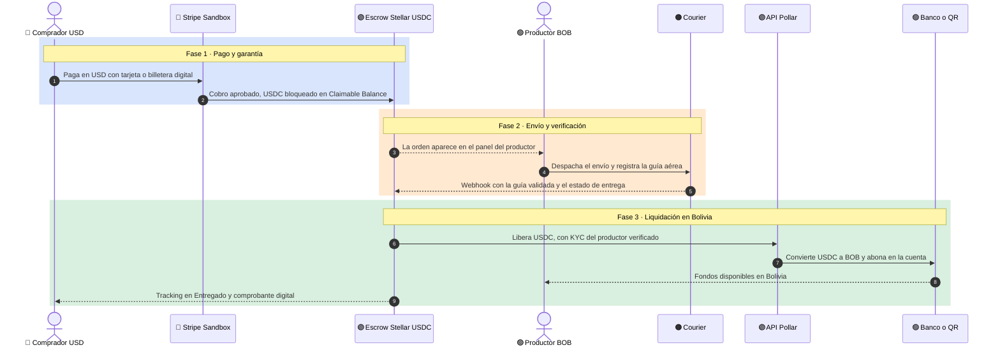
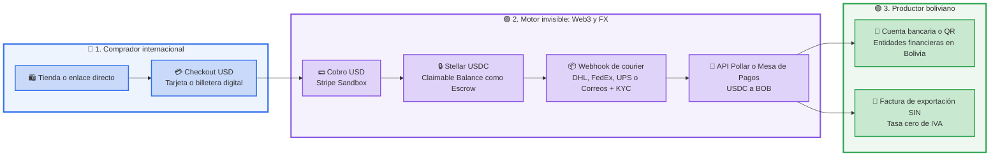
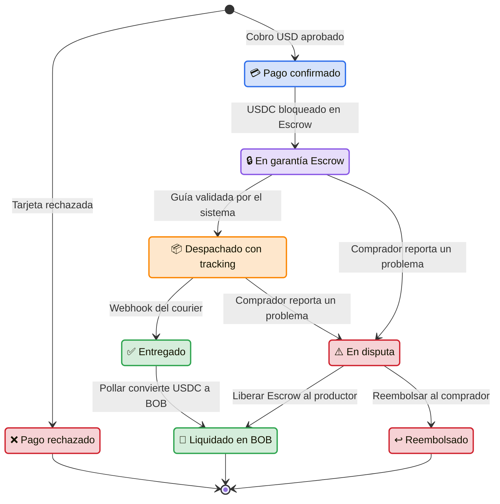
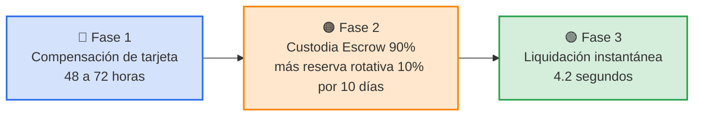
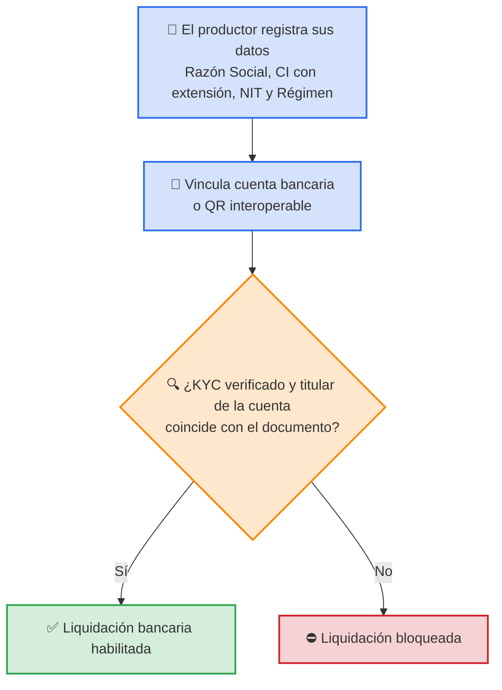
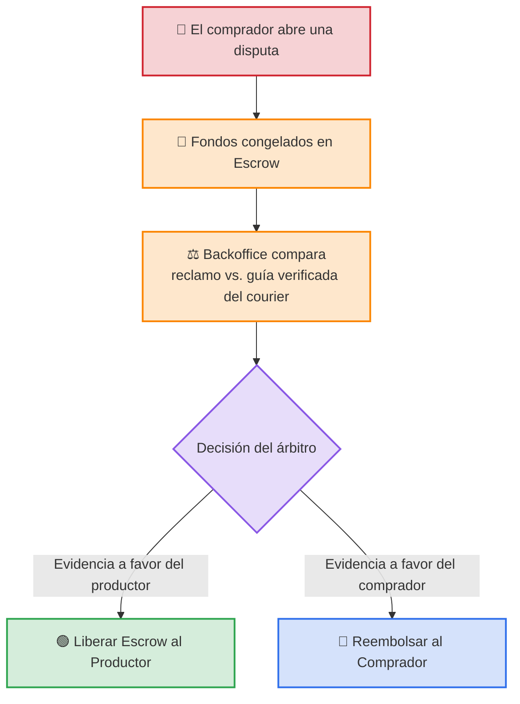

# Nodes
Prototipo piloto de pasarela financiera y habilitador de comercio transfronterizo en Bolivia


<div align="center">


<br>

El comprador internacional paga con su tarjeta habitual (en este piloto se modela el cobro en **USD** como divisa de ejemplo).<br>
El productor boliviano recibe **BOB** en su cuenta bancaria, referenciado a un tipo de cambio de mercado ilustrativo.<br>
La tecnología blockchain trabaja en segundo plano y nadie tiene que verla.

<br>


</div>

---

## 📋 Tabla de contenidos

1. [🎯 Resumen](#resumen)
2. [💡 El problema y la propuesta de valor](#propuesta)
3. [🔄 Cómo funciona](#como-funciona)
4. [🏗 Arquitectura del sistema](#arquitectura)
5. [📦 Ciclo de vida de una orden](#ciclo-de-vida)
6. [💰 Flujo del dinero](#flujo-del-dinero)
7. [🧩 Módulos y funcionalidades](#modulos)
8. [🔐 Motor invisible: Stellar y Pollar](#motor-invisible)
9. [📁 Estructura del código](#estructura)
10. [🚀 Instrucciones de ejecución](#ejecucion)
11. [🧪 Guía de demostración](#demo)
12. [🚧 Alcance y avisos importantes](#avisos)

---

<a id="resumen"></a>

## 🎯 Resumen

Esta aplicación es un **prototipo piloto** de una pasarela financiera y habilitador de comercio transfronterizo orientado a conectar productores y microcomercios bolivianos con compradores internacionales (con un enfoque inicial ilustrativo en mercados como Estados Unidos y Europa). El catálogo precargado —café de especialidad, textiles de alpaca, singani y cuero curtido— funciona como ejemplo representativo de bienes exportables de alto valor, no como una restricción de rubro ni de escala.

Tiene tres vistas que comparten un **estado global sincronizado en tiempo real**:

| Vista | Quién la usa | Moneda en el piloto | Qué puede hacer |
|---|---|---|---|
| 🔵 **Comprador** | Cliente en el extranjero | USD *(ejemplo de divisa)* | Explorar el catálogo de prueba, pagar, seguir su pedido y abrir disputas |
| 🟢 **Productor** | Exportador / microcomercio en Bolivia | BOB | Verificar su identidad, fijar precios, despachar, facturar y cobrar |
| 🟠 **Backoffice** | Mesa de finanzas y riesgo | USD, USDC y BOB | Gestionar liquidez, descalce financiero y arbitraje de contracargos |

Además incluye un panel opcional, el 🟣 **Modo Evaluador (Ver Motor Invisible)**, que muestra la infraestructura técnica en vivo.

### 🎨 Código de colores

Los mismos colores se usan en todos los diagramas de este documento:

| Color | Significado |
|---|---|
| 🔵 **Azul** | Comprador, cobro en USD |
| 🟣 **Violeta** | Motor invisible: Stellar, Escrow y Pollar |
| 🟢 **Verde** | Productor, bolivianos, éxito y liquidación |
| 🟠 **Naranja** | Backoffice, custodia, envío y riesgo |
| 🔴 **Rojo** | Rechazos, bloqueos y disputas |

---

<a id="propuesta"></a>

## 💡 El problema y la propuesta de valor

| | ❌ Sin la plataforma | ✅ Con la plataforma |
|---|---|---|
| 🔵 **Comprador** | Transferencias internacionales lentas y costosas, sin protección de compra | Paga con tarjeta o billetera digital compatible, con garantía de compra protegida |
| 🟢 **Productor** | Recibe BOB al tipo de cambio oficial de referencia (ej. 10.50) tras trámites bancarios largos | Recibe BOB a un tipo de cambio de mercado ilustrativo (ej. 11.98) |
| 🟠 **Confianza** | El comprador paga y espera a ciegas | El dinero queda en garantía (Escrow) hasta confirmar la entrega |
| 🟣 **Cumplimiento** | Difícil justificar el origen de los fondos | Factura de exportación y verificación KYC integradas |

### ✨ Reglas de oro de la experiencia de usuario

> [!TIP]
> **Tecnología invisible.** Ni el comprador ni el productor ven jerga cripto, wallets ni blockchains. Todo ocurre en segundo plano y solo se muestra bajo demanda en el Modo Evaluador.

> [!NOTE]
> **Estado sincronizado.** Una compra en la Vista Comprador aparece al instante en el Panel del Productor. Al validar la guía del courier, el tracking del comprador se actualiza. Al confirmarse la entrega, se libera el Escrow y se abona el dinero en Bolivia.

---

<a id="como-funciona"></a>

## 🔄 Cómo funciona

El recorrido completo de una venta, en tres fases (ilustrado con los parámetros del prototipo piloto):



---

<a id="arquitectura"></a>

## 🏗 Arquitectura del sistema

El sistema se divide en tres bloques: lo que ve el comprador, el motor invisible que mueve el dinero, y lo que recibe el productor.



---

<a id="ciclo-de-vida"></a>

## 📦 Ciclo de vida de una orden

Cada orden avanza por estados bien definidos. Si el comprador reporta un problema, los fondos se congelan hasta que el backoffice resuelva.



La barra de seguimiento que ve el comprador muestra cuatro etapas:

🔵 **Pago confirmado** → 🟣 **En garantía (Escrow)** → 🟠 **Despachado con tracking** → 🟢 **Entregado**

---

<a id="flujo-del-dinero"></a>

## 💰 Flujo del dinero

Como la tarjeta tarda en compensar pero el productor recibe su pago casi de inmediato, la plataforma gestiona un **descalce financiero** en tres fases. El backoffice lo monitorea en tiempo real.



| Fase | Qué ocurre | Dónde está el dinero |
|---|---|---|
| 🔵 **1. Compensación** | La red de tarjetas liquida el cobro | USD en adquirencia |
| 🟠 **2. Custodia** | El 90% queda en Escrow y el 10% se retiene como reserva rotativa durante 10 días para cubrir contracargos | USDC en la bóveda Stellar |
| 🟢 **3. Liquidación** | Se confirma la entrega y se convierte a bolivianos | BOB en la mesa de liquidación, luego en la cuenta del productor |

---

<a id="modulos"></a>

## 🧩 Módulos y funcionalidades

### 🔵 A. Vista Comprador Internacional (USD)

**1. Catálogo de exportación de alto valor**

| Producto | Origen |
|---|---|
| ☕ Café de especialidad | Yungas (Caranavi) |
| 🧣 Chalina de Baby Alpaca hecha a mano | La Paz |
| 🥃 Singani de Altura Gran Reserva D.O. | Tarija |
| 👜 Bolso de cuero curtido vegetal | Tupiza |

**2. Enlace de pago directo.** Cada producto tiene el botón *Copiar enlace de pago*, pensado para vender por WhatsApp o Instagram.

**3. Checkout transparente**
- Desglose exacto: producto en USD, envío internacional express (DHL) y Garantía Escrow de Compra Protegida (**$0.00**).
- Formulario de tarjeta con botones de prueba rápida: 🟢 *Simular Pago Exitoso* y 🔴 *Simular Tarjeta Rechazada*.

**4. Tracking post-compra y disputas**
- Barra de progreso de 4 etapas.
- Comprobante digital de compra, imprimible.
- Botón 🔴 *Reportar Problema / Abrir Disputa*, que congela los fondos y solicita arbitraje.

---

### 🟢 B. Vista Productor Boliviano (BOB)

#### B.1 Verificación de identidad (KYC / AML)

El productor registra su Razón Social, Cédula de Identidad con extensión (LP, SC, CB, etc.), NIT y Régimen Tributario, y vincula una cuenta bancaria o un QR interoperable (ASOBAN).



> [!IMPORTANT]
> **Regla estricta:** el sistema bloquea la liquidación si el KYC no está verificado o si el titular de la cuenta no coincide con el documento de identidad.

#### B.2 Calculadora inteligente de precios (cálculo inverso BOB → USD)

En lugar de pensar en dólares, el productor indica **cuántos bolivianos líquidos quiere recibir**, y la calculadora determina el precio que debe pagar el comprador en el extranjero.

- Compara en tiempo real el tipo de cambio de mercado (**11.98**) con el oficial (**10.50**), lo que equivale a **≈ +14.1% de ingresos netos**.
- Absorbe las comisiones en el precio final:

| Concepto | Valor |
|---|---|
| 🔵 Pasarela de pago | 3.9% + $0.30 |
| 🟣 Plataforma | 3% |

**Ejemplo con el liquidado de la demo (142.50 USDC):**

| Tipo de cambio | Bolivianos recibidos |
|---|---|
| 🔴 Oficial (10.50) | 1,496.25 BOB |
| 🟢 Mercado (11.98) | **1,707.15 BOB** |

La diferencia a favor del productor es de **210.90 BOB** en esta sola operación.

> [!NOTE]
> **Ejemplo de cálculo inverso.** Si el productor quiere recibir 500 BOB, necesita 500 ÷ 11.98 ≈ 41.74 USD netos. Suponiendo que ambas comisiones se aplican sobre el precio del producto, el comprador pagaría aproximadamente `(500 ÷ 11.98 + 0.30) ÷ (1 − 0.039 − 0.03) ≈ 45.15 USD`. Este cálculo es solo ilustrativo, ya que la lógica exacta está en `calculatorService.ts`.

#### B.3 Gestión de envíos y validación de guías aéreas

- 🚚 Selección de courier: **DHL Express, FedEx International, UPS o Correos de Bolivia EMS**.
- **Validación automática de formato:** 🔴 rechaza códigos cortos o inventados (por ejemplo `123`) y 🟢 aprueba códigos válidos (por ejemplo `DHL-BO-98231`).
- Botón demo *Simular Entrega Exitosa (Courier Webhook)* para acelerar la entrega física y disparar el abono bancario.

#### B.4 Módulo tributario y facturación SIN Bolivia

| Documento | Base legal | Para qué sirve |
|---|---|---|
| 🧾 **Factura Comercial de Exportación** | Tasa cero de IVA (Ley 843, Art. 11) | Se emite a nombre del productor y respalda el ingreso ante la UIF y la ASFI, justificando el origen lícito de los fondos |
| 🧾 **Factura de Comisión de Plataforma** | IVA 13% | Detalla el 3% de servicio y otorga Crédito Fiscal IVA al productor |

📊 También permite exportar el **Libro de Ventas en formato CSV**.

---

### 🟠 C. Vista Backoffice: Mesa de Finanzas y Riesgo

**1. Gestión de descalce financiero**
- Muestra las 3 fases del dinero (ver [Flujo del dinero](#flujo-del-dinero)).
- Indicadores de liquidez en tiempo real:

| Indicador | Qué mide |
|---|---|
| 🔵 **USD en adquirencia** | Dinero cobrado que aún no compensa la tarjeta |
| 🟣 **USDC en bóveda Stellar** | Fondos en custodia Escrow |
| 🟢 **BOB en mesa de liquidación** | Bolivianos listos para abonar a productores |

- ⏩ Simulador de paso del tiempo (**+48 horas** y **+10 días**).

**2. Centro de arbitraje de contracargos**
- Comparación lado a lado entre el reclamo del comprador y la guía verificada del courier.
- Acciones con efecto financiero inmediato: 🟢 *Liberar Escrow al Productor* o 🔵 *Reembolsar al Comprador*.



---

<a id="motor-invisible"></a>

## 🔐 Motor invisible: Stellar y Pollar

Un panel desplegable (drawer) con **terminal en vivo** que transmite logs con marcas de tiempo y hashes de transacción en **Stellar Testnet**. Está pensado para evaluadores técnicos y para demostrar que detrás del flujo simple existe infraestructura real.

Muestra dos elementos clave:

- 🟣 El contrato nativo de **Claimable Balance**, que actúa como Escrow.
- 🟣 El payload exacto que se envía a la **API Pollar** para liquidar en bolivianos:

```http
POST https://api.pollar.io/v1/settlements/bo
```

```json
{
  "amount_usdc": 142.50,
  "fx_rate_applied": 11.98,
  "recipient_account": "150-0928371-29",
  "recipient_bank": "Banco Nacional de Bolivia (BNB)",
  "recipient_name": "Asociación de Caficultores Bio-Yungas SRL"
}
```

---

<a id="estructura"></a>

## 📁 Estructura del código

```
/
├── index.html                    # Aplicación completa, ejecutable en cualquier navegador sin dependencias
├── start_server.py               # Lanzador en Python que abre el navegador automáticamente
├── package.json                  # Configuración npm para desarrollo en equipo
├── tsconfig.json                 # Configuración de TypeScript
├── vite.config.ts                # Configuración de Vite
├── README.md                     # Documentación técnica
├── assets/
│   └── banner.svg                # Banner de este README
└── src/
    ├── types/index.ts            # Interfaces TypeScript completas
    ├── services/
    │   ├── paymentGateway.ts     # Mock del on-ramp de tarjetas internacionales (Stripe Sandbox)
    │   ├── stellarMock.ts        # Mock de la red Stellar, Horizon API y Claimable Balance
    │   ├── pollarApiMock.ts      # Mock de la API Pollar / Mesa de Pagos (USDC a BOB en banco)
    │   ├── courierMock.ts        # Mock de APIs de rastreo: DHL, FedEx, UPS y Correos
    │   ├── calculatorService.ts  # Lógica de precios inversos y comisiones
    │   └── taxSinService.ts      # Generador de facturas SIN con tasa cero y crédito fiscal
    ├── context/AppContext.tsx    # Estado global reactivo con persistencia en LocalStorage
    ├── components/               # Componentes modulares de cada vista
    ├── App.tsx                   # Raíz de React
    └── main.tsx                  # Punto de entrada de React DOM
```

---

<a id="ejecucion"></a>

## 🚀 Instrucciones de ejecución

| Opción | Requisitos | Ideal para |
|---|---|---|
| 🟢 **1. Navegador directo** | Chrome, Edge o Firefox | Probar la demo en segundos |
| 🔵 **2. Servidor local con Python** | Python 3 | Evitar restricciones del protocolo `file://` |
| 🟣 **3. Vite / Node.js** | Node.js y npm | Desarrollo en equipo |

### 🟢 Opción 1: directamente en el navegador (sin dependencias)

Haz doble clic en `index.html` o ábrelo con Google Chrome, Microsoft Edge o Firefox.

### 🔵 Opción 2: servidor local con Python

```bash
python start_server.py
```

El script inicia el servidor HTTP y abre automáticamente tu navegador en `http://localhost:8000/index.html`.

### 🟣 Opción 3: modo Vite / Node.js

```bash
npm install
npm run dev
```

---

<a id="demo"></a>

## 🧪 Guía de demostración

Un recorrido de 5 minutos para ver todo el flujo de extremo a extremo:

- [ ] 🔵 **1. Prueba un rechazo.** En la Vista Comprador, elige un producto, abre el checkout y pulsa *Simular Tarjeta Rechazada*.
- [ ] 🔵 **2. Compra con éxito.** Repite el proceso con *Simular Pago Exitoso* y observa el tracking en *En garantía (Escrow)*.
- [ ] 🟢 **3. Cambia a la Vista Productor.** La orden recién creada ya aparece en el panel.
- [ ] 🟢 **4. Verifica el KYC.** Completa los datos de identidad y vincula la cuenta bancaria.
- [ ] 🟢 **5. Valida la guía aérea.** Ingresa `123` (será rechazada) y luego `DHL-BO-98231` (será aprobada).
- [ ] 🟢 **6. Simula la entrega.** Pulsa *Simular Entrega Exitosa (Courier Webhook)* y comprueba que se libera el Escrow y se abona el dinero.
- [ ] 🟢 **7. Revisa la facturación.** Abre el módulo tributario y exporta el Libro de Ventas en CSV.
- [ ] 🟠 **8. Explora el backoffice.** Avanza el tiempo con **+48h** y **+10 días**, y prueba una disputa.
- [ ] 🟣 **9. Abre el Motor Invisible.** Revisa los logs de Stellar Testnet y el payload de la API Pollar.

---

<a id="avisos"></a>

## 🚧 Alcance y avisos importantes

> [!WARNING]
> **Este proyecto es una demostración.** No mueve dinero real ni conecta con servicios financieros reales.

Todas las integraciones son simulaciones (*mocks*) que reproducen el comportamiento de los servicios reales:

| Componente simulado | Archivo | Servicio real al que representa |
|---|---|---|
| 🔵 Cobro con tarjeta | `paymentGateway.ts` | Stripe (modo Sandbox) |
| 🟣 Escrow con Claimable Balance | `stellarMock.ts` | Red Stellar y Horizon API (Testnet) |
| 🟣 Liquidación USDC a BOB | `pollarApiMock.ts` | API Pollar / Mesa de Pagos |
| 🟠 Rastreo de envíos | `courierMock.ts` | APIs de DHL, FedEx, UPS y Correos de Bolivia |
| 🟢 Facturación | `taxSinService.ts` | Sistema de Facturación del SIN |

- Los tipos de cambio de **10.50 BOB/USD** (oficial) y **11.98 BOB/USD** (mercado) son **parámetros de demostración**, no cotizaciones garantizadas.
- Los datos bancarios y razones sociales del ejemplo son ficticios.

> [!CAUTION]
> Antes de operar en producción, los aspectos regulatorios, tributarios y de cumplimiento (ASFI, UIF, SIN, normativa cambiaria y de comercio exterior) deben validarse con asesores legales y financieros especializados.

---

<div align="center">

🇧🇴 **Hecho para conectar a los productores de Bolivia con el mundo.**

</div>
